# ClinicMate

ClinicMate is a Flutter app for finding doctors and managing appointments. It connects patients with doctor listings, appointment booking, an AI assistant, and the information they need to manage their care.

**Backend for this app:** [ClinicMate backend repository](https://github.com/wasimasghar/clinicMate)

## What you can do

- Create an account or sign in with your phone number.
- Browse specialties and cities, then search and filter doctors.
- View doctor profiles, clinic locations, availability, and reviews.
- Check a booking quote before selecting an appointment slot.
- Book, cancel, and reschedule appointments, and leave a review.
- Join a doctor's waiting list and act on an offered appointment slot.
- Chat with the assistant, which can suggest doctors and appointment options.
- View and update your patient profile.

## App screenshots

The screenshots below are stored in this repository's `screenshots/` folder. GitHub renders them in this README, and each image links to its full-size file.

### Getting started and doctor search

| Splash screen | Home | Doctor search |
| --- | --- | --- |
| <a href="screenshots/splash_screen.PNG"></a> | <a href="screenshots/home_screen.PNG">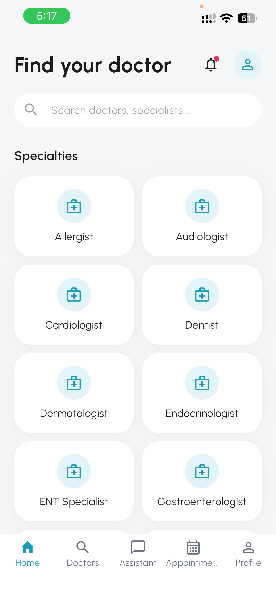</a> | <a href="screenshots/search_screen.PNG">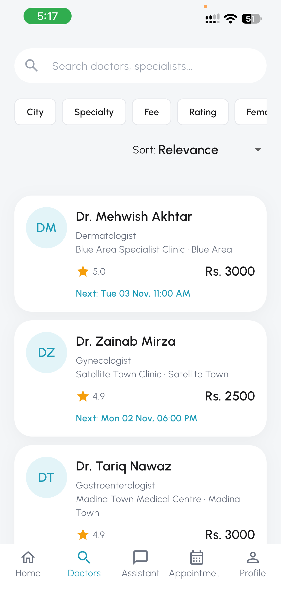</a> |

### Doctor profiles and appointments

| Doctor profile | Doctor profile details | Appointments |
| --- | --- | --- |
| <a href="screenshots/doc_detail.PNG">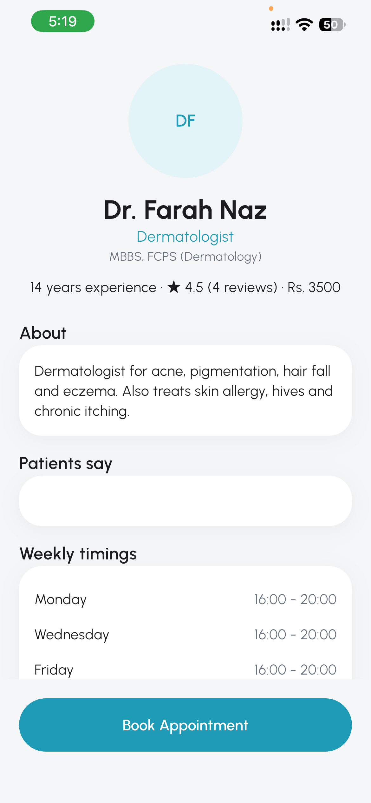</a> | <a href="screenshots/doc_detail_2.PNG">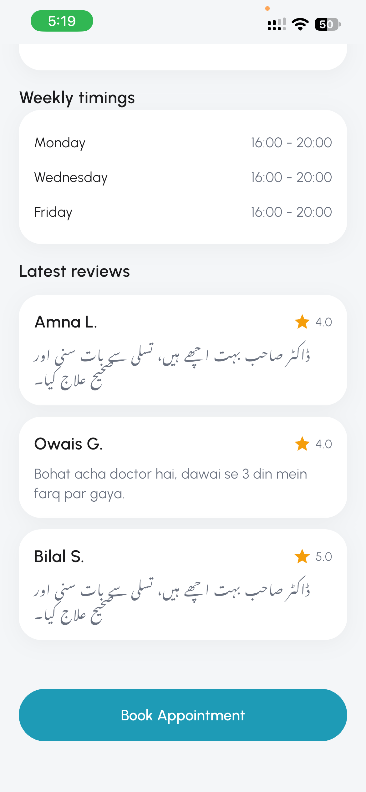</a> | <a href="screenshots/appointment_scren.PNG">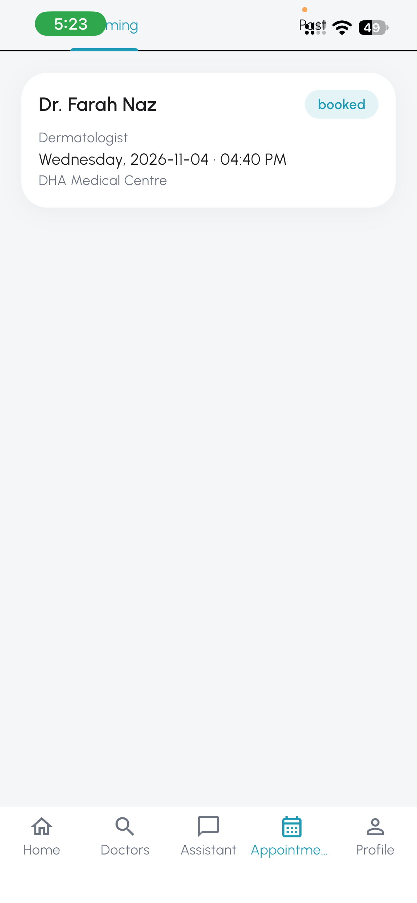</a> |

| Appointment list and cancellation | Appointment cancelled |
| --- | --- |
| <a href="screenshots/chekcing_and_cancling_appoinments.PNG">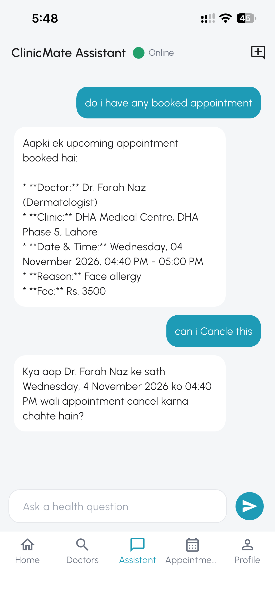</a> | <a href="screenshots/appoinment_cancled.PNG">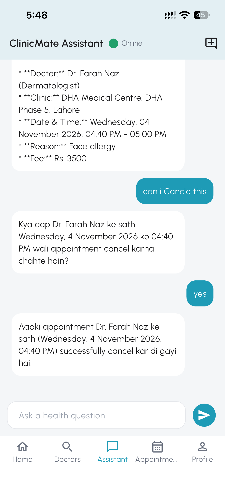</a> |

### Assistant chat

| Chat response | More chat | Doctor suggestions |
| --- | --- | --- |
| <a href="screenshots/chat_2_qa.PNG">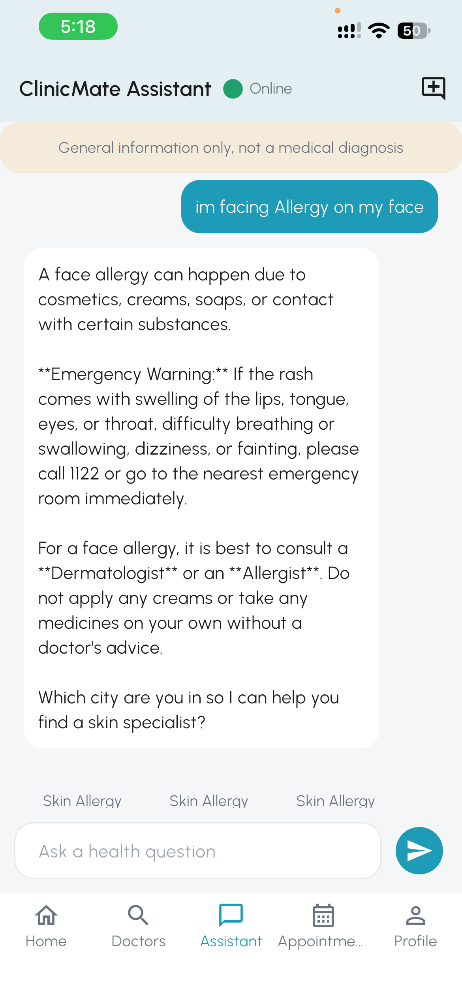</a> | <a href="screenshots/chat_3_QA.PNG">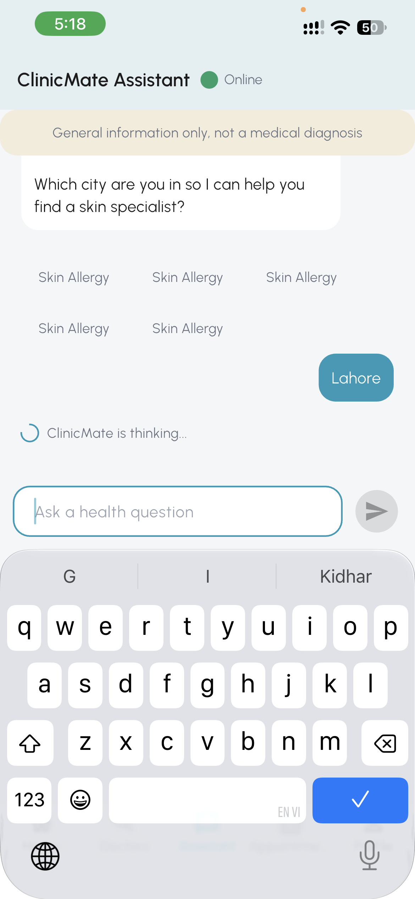</a> | <a href="screenshots/chat_5_doc_suggessions.PNG">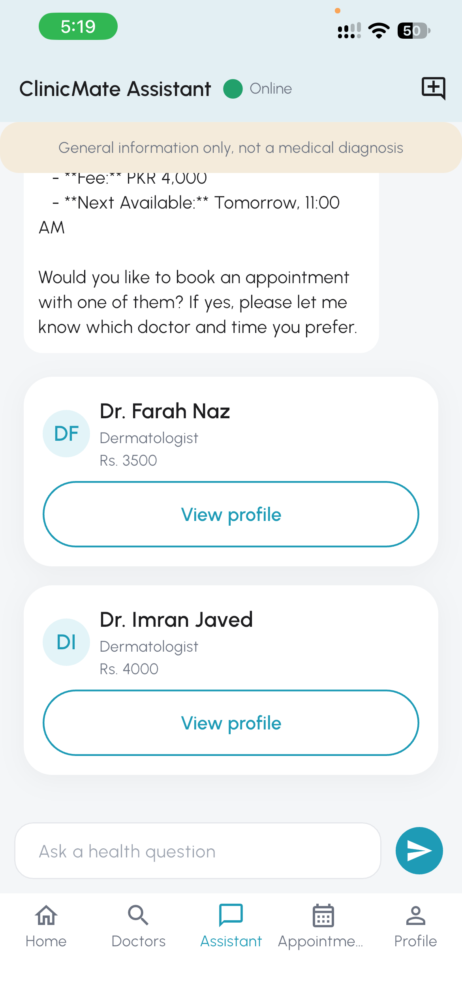</a> |

| Assistant answer | Follow-up doctor request |
| --- | --- |
| <a href="screenshots/chat_4_QA.PNG">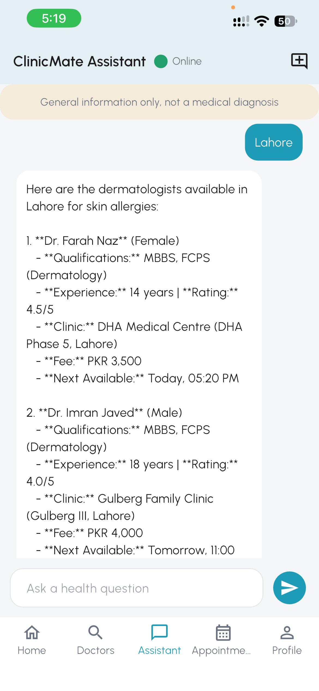</a> | <a href="screenshots/chat_asking_for_more_doc.PNG">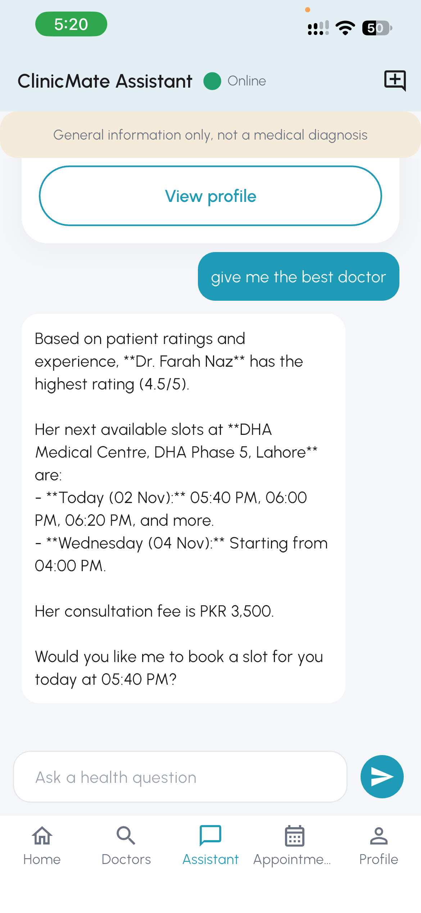</a> |

| Chat loading state | Suggested appointment slots | Booking conversation |
| --- | --- | --- |
| <a href="screenshots/chat_doing_query_loading.PNG">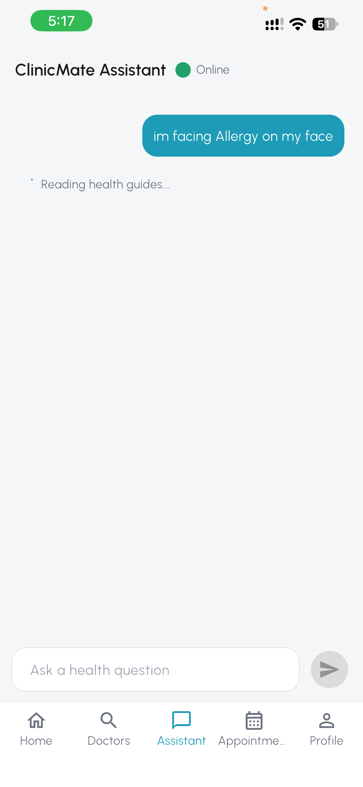</a> | <a href="screenshots/chat_doc_slots.PNG">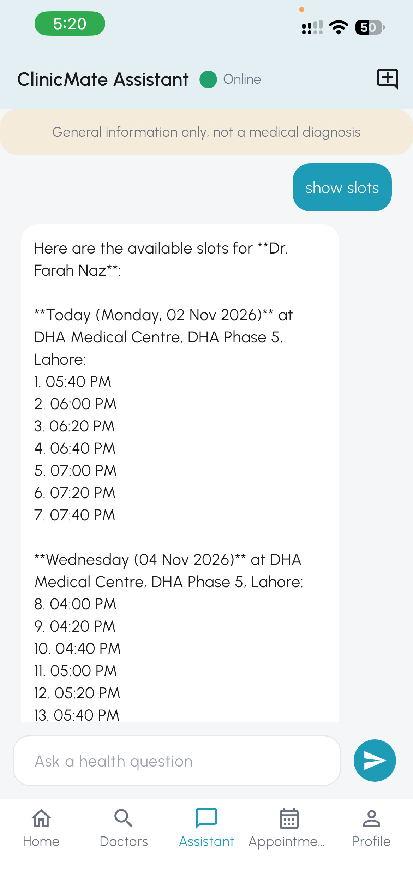</a> | <a href="screenshots/chat_booking_apointment.PNG">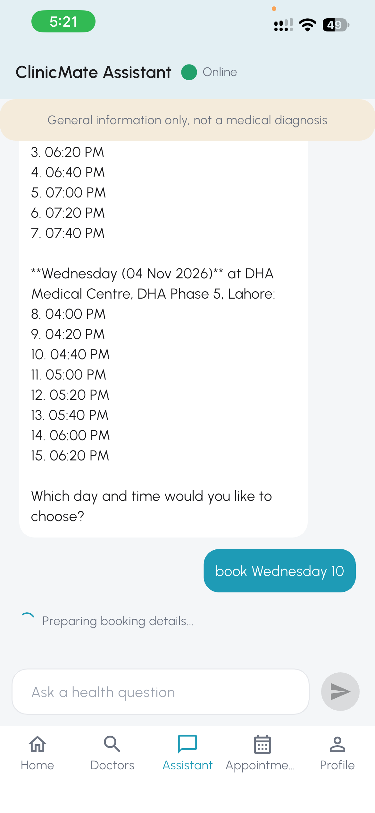</a> |

| Booking confirmation | Booking confirmation details | Appointment booked |
| --- | --- | --- |
| <a href="screenshots/chat_confermation_appointment.PNG">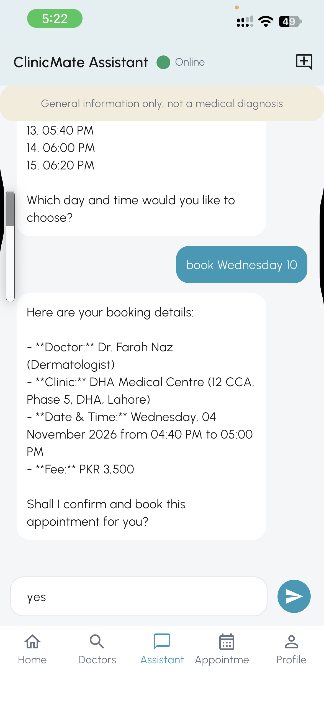</a> | <a href="screenshots/chat_confermation_2.PNG">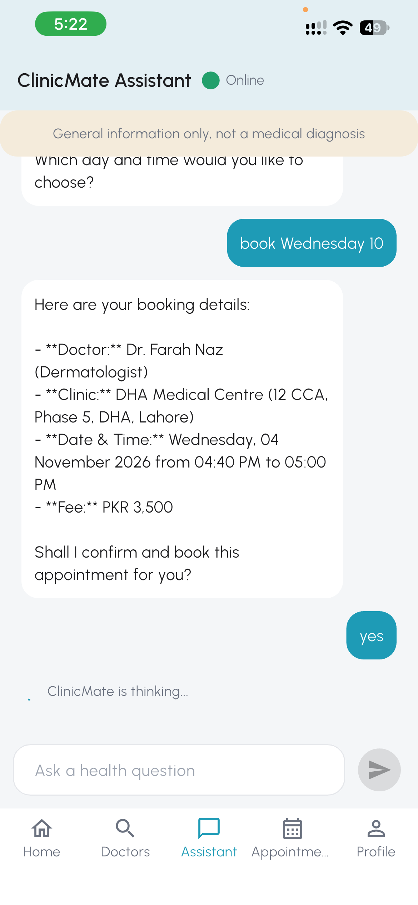</a> | <a href="screenshots/chat_apoinemnt_booked.PNG">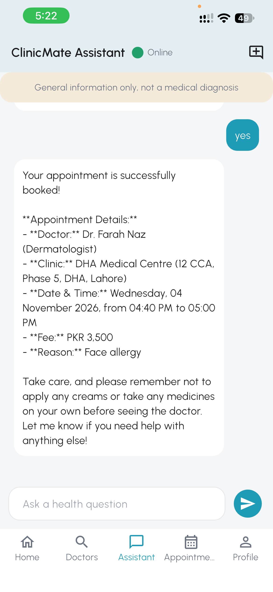</a> |

## Run locally

### Requirements

- Flutter SDK compatible with the Dart SDK constraint in `pubspec.yaml`.
- An Android emulator, iOS simulator, or connected device.
- A running ClinicMate backend reachable from the device.

Fetch packages and start the app from the project directory:

```bash
flutter pub get
flutter run --dart-define=API_BASE_URL=http://10.0.2.2:8000
```

`10.0.2.2` is the Android emulator address for services running on the development computer. For a physical phone or iOS simulator, replace it with the computer's LAN IP address, and make sure the phone and computer can reach each other on the network. The backend must be running and listening on that network interface.

## Backend

ClinicMate uses a separate backend service for authentication, doctor search, appointments, waiting lists, profiles, and assistant chat.

**Backend repository:** [ClinicMate backend on GitHub](https://github.com/wasimasghar/clinicMate)

Set `API_BASE_URL` at run time to point the app at that backend. The default configured for Android emulator development is `http://10.0.2.2:8000`.

## Built with

- Flutter and Dart
- Dio for HTTP requests and streamed assistant responses
- `flutter_secure_storage` for session token storage
- `flutter_bloc` for app state management

## Project layout

```text
lib/
  app/       App setup, route configuration, and shared dependencies
  core/      Configuration, networking, and secure token storage
  data/      API models and repositories
  features/  Authentication, doctors, booking, chat, appointments, and profile
screenshots/ App screenshots shown above
```

